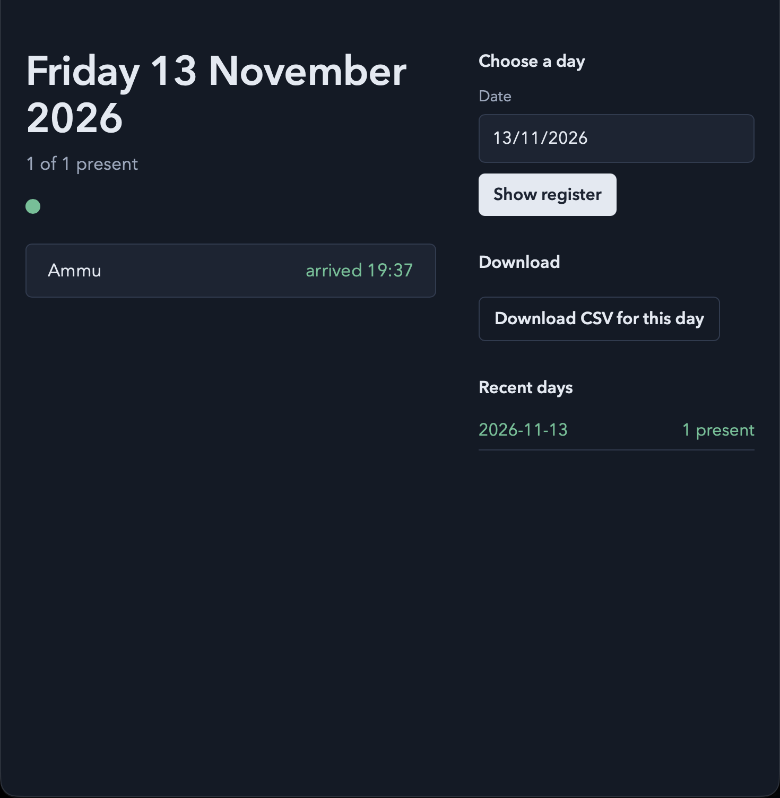

# Face Attendance System

[](https://github.com/spoorthy1908/face-attendance/actions/workflows/tests.yml)

A computer vision attendance system that recognises people from a webcam, checks that they are a real person and not a photo, and records attendance automatically. Attendance can be viewed and exported from a web dashboard.



## Features

- **Face registration**: capture a few samples of a person and store them as face embeddings
- **Real-time recognition**: identify registered people from a live webcam feed
- **Liveness check**: people must turn their head side to side, which blocks simple photo spoofing
- **Reliable marking**: a person must be recognised across several frames in a row before being marked present, and is recorded only once per day
- **Web dashboard**: view who was present or absent on any day, browse recent days, and download a CSV report
- **Privacy first**: no photos are stored, only face embeddings, and all personal data stays local and out of Git

## How it works

1. **Detection**: OpenCV's [YuNet](https://github.com/opencv/opencv_zoo/tree/main/models/face_detection_yunet) model finds faces in each frame and returns five landmarks (eyes, nose and mouth corners).
2. **Embedding**: each face is aligned and passed through [SFace](https://github.com/opencv/opencv_zoo/tree/main/models/face_recognition_sface), which turns it into a 128-number vector that describes the face.
3. **Matching**: the new embedding is compared with every registered sample using cosine similarity. The best match above a threshold of 0.363 is accepted; anything lower is shown as Unknown.
4. **Liveness**: the system measures where the nose sits between the eyes. On a real, 3D head this ratio changes as the head turns; on a flat photo it stays almost constant, even when the photo is tilted.
5. **Logging**: attendance is written to a SQLite database, with a `UNIQUE(name, date)` constraint so nobody is counted twice in a day.

## Tech stack

Python, OpenCV (YuNet + SFace), NumPy, SQLite, Flask, pytest, GitHub Actions

## Getting started

```bash
git clone https://github.com/spoorthy1908/face-attendance.git
cd face-attendance
python3 -m venv venv
source venv/bin/activate          # Windows: venv\Scripts\activate
pip install -r requirements.txt
python scripts/download_models.py
```

## Usage

| Command | What it does |
| --- | --- |
| `python src/register.py` | Register a new person (press Space to capture 5 samples) |
| `python src/recognize.py` | Live recognition demo with similarity scores |
| `python src/take_attendance.py` | Take attendance with the liveness check |
| `python src/attendance.py [YYYY-MM-DD]` | Print attendance for today or a given day |
| `python src/app.py` | Start the dashboard at http://127.0.0.1:5001 |
| `pytest` | Run the test suite |

Settings such as thresholds and the camera index live in `src/config.py`.

## Project structure

```
face-attendance/
├── scripts/download_models.py   # downloads the pre-trained models
├── src/
│   ├── config.py                # paths and settings
│   ├── face_utils.py            # camera, detection and embedding helpers
│   ├── detect.py                # face detection demo
│   ├── register.py              # register new people
│   ├── recognize.py             # matching logic and recognition demo
│   ├── liveness.py              # head-turn liveness check
│   ├── attendance.py            # SQLite storage
│   ├── take_attendance.py       # main attendance program
│   ├── app.py                   # Flask dashboard
│   └── templates/dashboard.html
└── tests/                       # pytest test suite
```

## Limitations and future work

- The head-turn check stops photos but not a replayed video. A trained anti-spoofing model or a depth camera would be the next step.
- Recognition accuracy drops in poor lighting or with large head angles. Capturing more varied samples at registration helps.
- Matching compares against every stored sample, which is fine for a class but would need a vector index (such as FAISS) for thousands of people.
- Possible additions: login for the dashboard, per-class sessions, and email reports.

## Privacy

Face embeddings are biometric personal data. Only register people who have given their consent. The `data/` folder, which holds embeddings and attendance records, is excluded from Git so it is never published.
